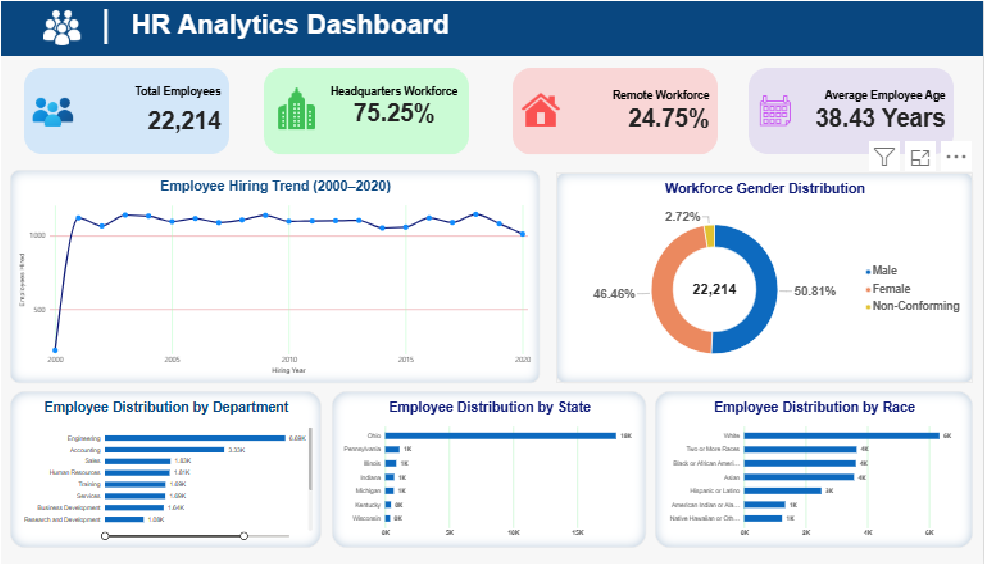
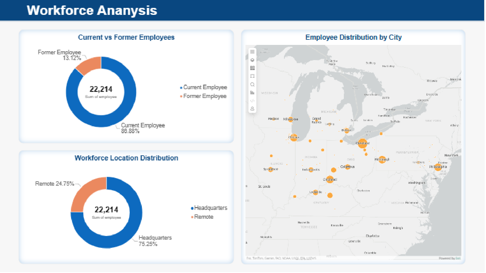
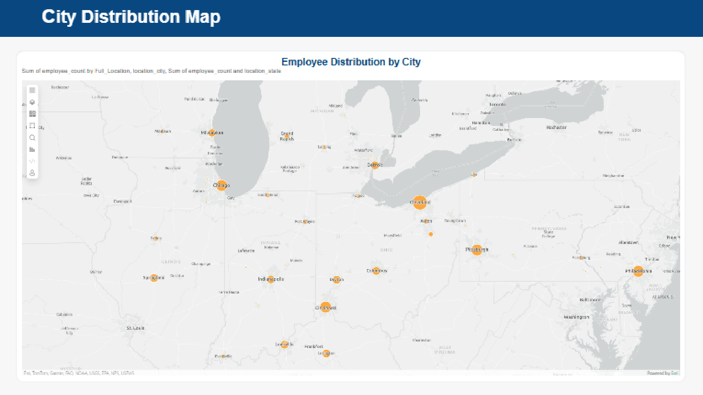

# HR Analytics Project | SQL & Power BI

## Project Overview

This project focuses on analysing workforce data to identify employee distribution patterns, hiring trends, workforce demographics, and termination trends.

The objective is to transform raw HR data into meaningful business insights using SQL and Power BI, helping organisations better understand their workforce and support data-driven HR decisions.

## Project Objectives

- Analyse employee demographics and gender distribution.
- Examine hiring trends over time.
- Understand department and job-title distribution.
- Analyse workforce distribution by state, city, and work location.
- Study employee age groups.
- Examine employee termination trends.
- Develop an interactive HR analytics dashboard.

## Tools & Technologies

| Tool | Purpose |
|---|---|
| MySQL Workbench | Data analysis and SQL queries |
| SQL | Data cleaning, validation, aggregation and analysis |
| Power BI | Data visualisation and dashboard development |
| Microsoft Excel / CSV | Data handling and exports |
| Microsoft Word | Project documentation |
| Microsoft PowerPoint | Project presentation |
| Git & GitHub | Version control and project hosting |

## Dataset Overview

- Total employee records: **22,214**
- Total columns: **14**
- Unique job titles: **185**
- Departments: **13**

The dataset contains employee-related information, including demographics, hiring dates, termination dates, job titles, departments, and work locations.

## SQL Analysis

The project includes SQL scripts covering the following analyses:

1. Hiring Trend Analysis
2. Gender Distribution
3. State Distribution
4. Department Distribution
5. Race Distribution
6. HR KPI Summary
7. Employee Status Analysis
8. Location Distribution
9. City Distribution
10. Job Title Analysis
11. Age Group Analysis
12. Termination Analysis

Data validation and aggregation were performed to support accurate analysis and reporting.

## Power BI Dashboard

The Power BI dashboard presents workforce insights through interactive visualisations and KPI summaries.

### Dashboard Screenshots

**1. HR Overview**



**2. Workforce Analysis**



**3. City Distribution Map**



## Key Findings

- The dataset contains 22,214 employee records.
- Male employees account for approximately 50.81% of the workforce, female employees 46.46%, and non-conforming employees 2.72%.
- The headquarters workforce represents approximately 75.25% of all employee records.
- Cleveland, Ohio, accounts for 16,871 employee records.
- The 26–35 age group represents approximately 27.56% of the workforce.
- Research Assistant II is the most common job title, with 754 employees.
- The termination analysis identified 2,915 completed terminations and 1,014 future-dated termination records as of November 3, 2026.

## Business Recommendations

- Review workforce distribution across departments and locations to support resource planning.
- Monitor hiring patterns to understand workforce growth.
- Evaluate demographic distribution to support inclusive workforce planning.
- Review employee termination trends to identify areas requiring further investigation.
- Use job-title and age-group analysis to support workforce planning and talent management.

## Project Structure

```text
HR_Analytics_Project/
│
├── 01_Documentation/
├── 02_PowerBi_Dashboard/
├── 03_Presentation/
├── 04_SQL_Scripts/
├── 05_CSV_Data/
├── 06_Screenshots/
└── 07_Final_Submission/
```

## Project Deliverables

- SQL analysis scripts
- CSV analysis outputs
- Interactive Power BI dashboard
- Project documentation in Word and PDF
- Project presentation in PowerPoint
- Dashboard screenshots

## Skills Demonstrated

- SQL querying and data analysis
- Data validation and aggregation
- Workforce analytics
- Exploratory data analysis
- Power BI dashboard development
- Data visualisation
- Business insight generation
- Technical documentation
- Git and GitHub version control

## Conclusion

This project demonstrates an end-to-end HR analytics workflow, from analysing workforce data using SQL to presenting insights through Power BI dashboards.

It showcases practical analytical skills and the ability to translate workforce data into meaningful business insights.

---

**Project Category:** Data Analytics | HR Analytics

**Tools:** MySQL, SQL, Power BI, Excel, Git & GitHub
